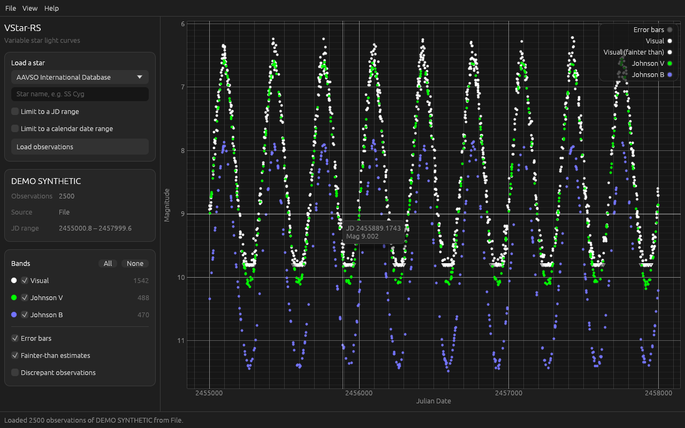

# FeStar

A redesign of VStar with new AI integrations: a modern, fast desktop app for
variable star light curve analysis, written in Rust. It is a rewrite of [AAVSO VStar](https://github.com/AAVSO/VStar), which
it uses as the reference for its data loaders and analysis methods.



## Status

This is step 1 of 4 in the plan:

1. **Foundation (this step):** the app window, AAVSO and BAA data loading, and
   an interactive light curve. *Done.*
2. **Analysis:** period search (DCDFT, Lomb-Scargle and others, ported from
   VStar), phase plots, and favourite stars whose data is preloaded at startup.
3. **Gaia:** Gaia DR3 epoch photometry for the selected star.
4. **AI and packaging:** optional AI help choosing period-search settings and
   explaining results, then a Windows installer.

Windows is the first target. The code is portable, so macOS and Linux builds
can follow.

## What works now

- **AAVSO International Database:** type a star name (e.g. `SS Cyg`) and load
  its observations, optionally limited to a JD range. Star details (type,
  period, spectral type, coordinates) come from VSX.
- **BAA VSS database:** download a star's observations as CSV from the
  [BAA VSS database](https://britastro.org/vssdb/data.php) and open the file.
- **Other files:** AAVSO download files, VStar "simple format" files, and most
  CSV or tab-separated files with JD (or UT date) and magnitude columns.
- **Light curve:** zoom, pan, hover for details of each observation, per-band
  colours matching VStar, error bars, fainter-than estimates and discrepant
  observations on or off.
- Light, dark or follow-Windows theme. Recent stars and settings are
  remembered between runs.

## Getting the Windows app

Every push to `main` builds the Windows app in GitHub Actions. Open the latest
run under the **Actions** tab and download the `festar-windows` artifact. It
contains `festar.exe`, which runs without installing anything.

If the window stays blank on an older PC, set the environment variable
`VSTAR_OPENGL=1` to use the OpenGL renderer instead of DirectX 12.

## Building from source

Install Rust from <https://rustup.rs>, then:

```
cargo run --release -p vstar-app
cargo test
```

You can also pass a data file to open at startup:
`festar path\to\observations.csv`.

## Layout

- `crates/vstar-core`: data model, data sources and parsing. No UI code, fully
  unit-tested.
- `crates/vstar-app`: the desktop app (egui / eframe).

## Licence

VStar is licensed under the GNU Affero General Public License v3, and this
project ports code from it, so FeStar is under the same licence. See
[LICENSE](LICENSE).

Please acknowledge the data sources you use: the AAVSO International Database,
the BAA VSS database ("The BAA Photometry Database is acknowledged as the (part)
source of data on which this article was based"), and ESA Gaia.
